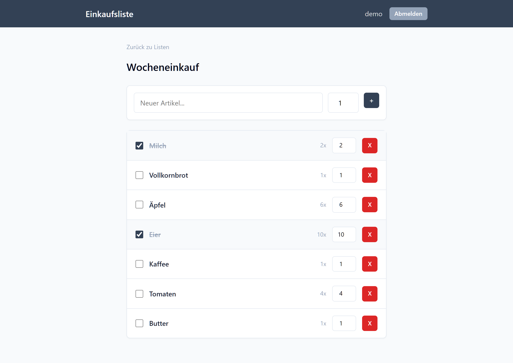
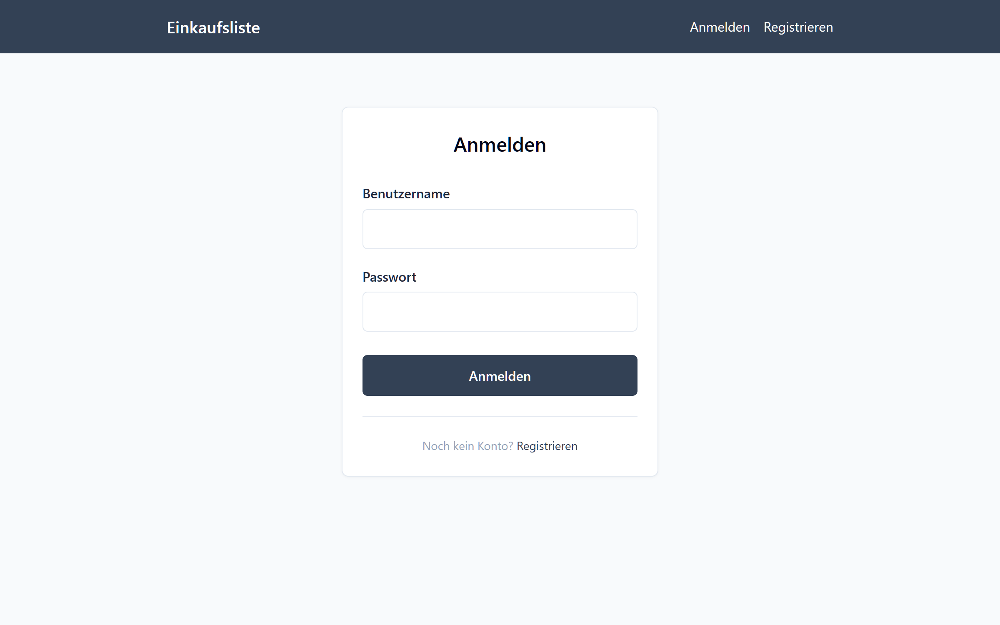
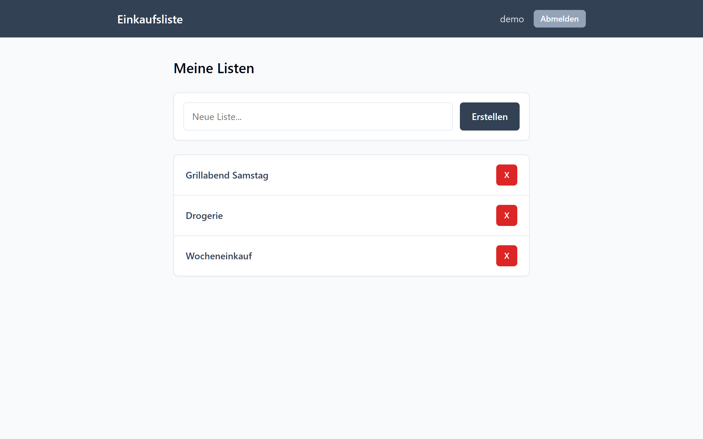
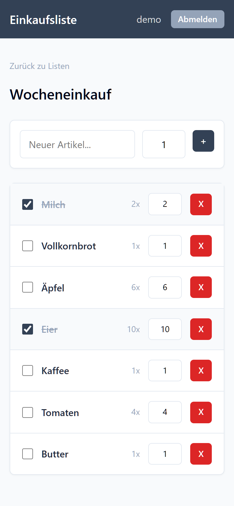

# Einkaufsliste – Frontend

Eine Web-App für Einkaufslisten: Konto anlegen, Listen erstellen, Artikel mit Menge eintragen und beim Einkaufen abhaken. Gebaut mit **Astro** und **Svelte 5**. Die Daten kommen von einer eigenen REST-API (Express + MySQL): [BE_einkaufsliste](https://github.com/fresco42/BE_einkaufsliste).

Entstanden als Semesterprojekt im 3. Semester Medientechnik an der FH St. Pölten.




<table>
  <tr>
    <td></td>
    <td></td>
    <td width="22%"></td>
  </tr>
  <tr>
    <td align="center">Login</td>
    <td align="center">Listenübersicht</td>
    <td align="center">Mobil</td>
  </tr>
</table>

## Funktionen

- Registrierung und Login mit JWT. Der Token bleibt im Browser gespeichert, man ist also nach dem Neuladen noch angemeldet.
- Eigene Einkaufslisten anlegen, öffnen und löschen
- Artikel mit Menge hinzufügen, Menge direkt in der Liste ändern, abhaken und entfernen
- Verständliche Fehlermeldungen, z. B. bei fremden Listen (403), nicht vorhandenen Listen (404) oder wenn der Server nicht erreichbar ist
- Responsives Layout für Desktop und Smartphone

## Technische Umsetzung

| Bereich | Umsetzung |
| --- | --- |
| Routing und Seiten | Astro mit dateibasiertem Routing und Node-Adapter (SSR, standalone) |
| Interaktive UI | Svelte-5-Komponenten mit Runes (`$state`, `$props`, `$effect`), eingebunden als Astro-Islands (`client:load`) |
| Auth-State | Ein globaler Store in [`auth.svelte.ts`](src/lib/auth.svelte.ts) mit Runes. Er hält User und Token und gleicht sie mit `localStorage` ab. |
| API-Anbindung | Typisierter Client in [`api.ts`](src/lib/api.ts). Jede Antwort ist ein `{ success, data }` oder `{ success, error }`, so muss jede Komponente den Fehlerfall behandeln. |
| Typen | Gemeinsame Interfaces für `User`, `List` und `Item` in [`types/api.ts`](src/types/api.ts) |
| Styling | Eigenes CSS mit Variablen, ohne UI-Framework |

```
Browser (Astro + Svelte)  ──HTTP/JSON + JWT──▶  Express-API  ──▶  MySQL (Docker)
```

## Lokal starten

Voraussetzungen: Node.js 20 oder neuer und das laufende [Backend](https://github.com/fresco42/BE_einkaufsliste).

```bash
npm install
cp .env.example .env   # PUBLIC_API_URL auf das Backend zeigen lassen
npm run dev
```

Die App läuft dann auf `http://localhost:4321`.

### Zusammen mit dem Backend

Die Datenbank läuft im Backend-Projekt als MySQL-Container. Die Daten liegen im Docker-Volume `einkaufsliste-db`.

1. Datenbank starten (im Backend-Ordner): `docker compose up -d`
2. Backend starten (im Backend-Ordner): `npm start`, läuft auf `http://localhost:3000`
3. Frontend starten (hier): `npm run dev`

Die Daten bleiben beim Stoppen erhalten. Nur `docker compose down -v` löscht das Volume und damit alle Daten.

### Umgebungsvariablen

| Datei | Wird genutzt von | Inhalt |
| --- | --- | --- |
| `.env` | `npm run build`, `npm run preview` | `PUBLIC_API_URL` des deployten Backends |
| `.env.development` | `npm run dev` | `PUBLIC_API_URL=http://localhost:3000` (lokales Backend) |

Im Dev-Modus überschreibt `.env.development` die Werte aus `.env`. Beide Dateien sind nicht im Git. Nach einer Änderung muss der Dev-Server neu gestartet werden.

## Skripte

| Befehl | Beschreibung |
| --- | --- |
| `npm run dev` | Entwicklungsserver |
| `npm run build` | Produktions-Build nach `dist/` (Node-Adapter, standalone) |
| `npm run preview` | Build lokal ansehen |
| `npm run lint` | Typprüfung mit `astro check` |

## Seiten

| Pfad | Inhalt |
| --- | --- |
| `/` | Login |
| `/register` | Registrierung |
| `/lists` | Übersicht der eigenen Listen |
| `/lists/:id` | Artikel einer Liste |

## Projektstruktur

```
src/
  components/   Svelte-Komponenten (Formulare, Listen, Navigation)
  layouts/      Astro-Layout
  lib/          API-Client und Auth-Store
  pages/        Routen
  styles/       Globales CSS
  types/        API-Typen
docs/
  screenshots/  Bilder für dieses README
```
